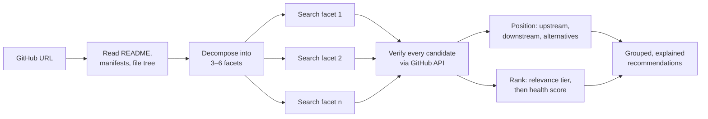

<div align="center">

# repo-compass

**Find similar GitHub repositories and better alternatives — for any repo.**

*Where does this GitHub repo sit, and should I use it?*

An agent skill (and Claude Code plugin) that turns one GitHub URL into a map: what the repo is made of, what it builds on, who builds on it, which alternatives exist, and how healthy each one is — with every claim traced to a fetched page or an API number.

[English](README.md) · [简体中文](README.zh-CN.md)

[](LICENSE)
[](https://github.com/exordor/repo-compass/stargazers)
[](skills/github-similar-repos/SKILL.md)
[](#install)

</div>

---

## The problem

GitHub has no "related repositories". Trending ranks by star velocity, so it shows you what went viral this week. Topics is a flat tag bag. The dashboard feed shows what people you follow starred. None of them answer the question you actually have when a link lands in your timeline:

> *Is this the real thing, or a thin wrapper around something more mature? Who else does this? Is it still maintained? Which one should I pick?*

repo-compass answers that, for any repo, including the 40-star ones that Trending will never show you.

## What you get

Paste a link into an agent that has the skill installed:

```
Saw https://github.com/hugohe3/ppt-master on Twitter. What is it built on,
and is it worth using or is there something better?
```

and you get back something like this (condensed from [the full example](examples/hugohe3-ppt-master.md)):

> **Positioning.** ppt-master is an agent skill, not an app: the LLM writes constrained SVG per slide and an in-house `svg_to_pptx` package compiles it to native DrawingML. `python-pptx` is only used as a shell — so this is *not* a wrapper over PptxGenJS or html2pptx. Facets: document → editable deck (intent); LLM-writes-SVG → own converter (route); agent skill (form); native PowerPoint object model (signature).
> **Health:** created 2025-12-10, ★63.5k (~200/day, +8k in the last 30 days), last push yesterday, 9 open issues, MIT. A launch still exploding, not an institution.
>
> **Downstream.** `byungjunjang/slide-master` (★289) is a self-described customised fork. No ports or UIs yet.
>
> **Alternatives — same job, different trade-offs**
> - `presenton` (★10.8k, Apache-2.0) — web app + API + MCP server. Better for a team that wants a hosted tool. ppt-master is better for working inside your coding agent.
> - `banana-slides` (★15.3k, AGPL, last push 3 months ago) — image-model route, each slide a generated picture. Better for visual-first decks; output is not editable.
> - `icip-cas/PPTAgent` (★5.1k) — the research project behind the html2pptx route; no Windows support.
>
> **Verdict:** on the native-editable-PPTX route, ppt-master is currently the most mature and most active option.
>
> **Closest — share most facets** … **Same route** … **Same ecosystem** … *(grouped list continues)*

Six more complete runs, across six domains, are in [`examples/`](examples/).

## Install

repo-compass is a standard [Agent Skill](https://agentskills.io): a folder with a `SKILL.md`. It needs an agent that can search the web and fetch pages (Claude Code, Codex, Cursor, Gemini CLI, and most others).

**Claude Code plugin**

```
/plugin marketplace add exordor/repo-compass
/plugin install repo-compass@repo-compass
```

**Any skill-compatible agent**

```bash
npx skills add exordor/repo-compass
```

**Manual**

```bash
git clone https://github.com/exordor/repo-compass
cp -r repo-compass/skills/github-similar-repos ~/.claude/skills/
```

Then just paste a GitHub URL and ask: *"what's similar"*, *"is this the best one"*, *"what is it built on"*, *"who else does this"*. The skill triggers on intent, not on magic words.

## How it works

The core idea is that **a repository is never just one thing**. A single repo is simultaneously a solution to a problem, a technical route, a kind of artefact, a member of an ecosystem, and one unusual choice. A nearest-neighbour search over one embedding collapses all of that into "most similar overall", which is usually the same author's other repos. repo-compass searches along each facet separately and keeps the facets visible in the output.



**The facets.** Intent (what problem, for whom), technical route (from dependency manifests, the most honest signal a repo has), output form (library / CLI / skill / showcase / dataset / tutorial…), ecosystem (Claude Code skills, HuggingFace, Obsidian plugins…), and *signature*: the one detail you'd mention first when describing it to a friend. The signature facet is the one most tools skip and the one that finds the best matches. See [`references/facets.md`](skills/github-similar-repos/references/facets.md).

**Verification is non-negotiable.** Search snippets lie by omission. Every recommended repo is checked against `api.github.com/repos/<owner>/<repo>`, which also catches renames, transfers, archived repos and forks. In testing, this step caught a repo that had been redirected to a different company's project, one archived the previous year, and four that had moved owners since the awesome-list that mentioned them was written.

**Two-layer ranking.** Relevance comes first and is the model's judgement: how many facets a candidate shares, or whether it does the exact same job. Health comes second and only orders within a tier. A 40-star repo on the identical route stays above a 10k-star repo in the general area; otherwise the output degenerates back into Trending.

**Health score** (`scripts/repo_health.py`) is a 0–100 summary of columns the output also shows:

| Signal | Weight | Why |
|---|---|---|
| Days since last push | 35% | The hardest single fact about whether anyone is home. Half-life 90 days. |
| Traction | 25% | log₁₀(stars), so a 100k-star project doesn't drown everything; bonus for high stars/day. |
| Maintenance | 25% | Issue close rate and PR merge rate. The repo API's `open_issues_count` silently includes PRs, so the script counts them separately. |
| Maturity | 15% | Age (saturates at 3 years) and whether it ships releases. |

Stars are always shown next to **stars per day since creation**. 20k stars in 30 days and 20k stars in 5 years are different objects; the first is a launch, the second is an institution, and you should know which one you're looking at.

## How it compares

| | Trending / Explore | SimRepo, GitRec | repo-compass |
|---|---|---|---|
| Signal | star velocity | star co-occurrence / collaborative filtering | README + manifests + topics, read by an LLM |
| Finds repos with <100 stars | no | rarely (needs co-stars) | yes — that's the point |
| Explains *why* it's related | no | no | every line |
| Upstream / downstream | no | no | yes |
| Alternatives with a verdict | no | no | yes, with API numbers |
| Latency | instant | instant | 2–5 min per query |
| Cost | free | free | your agent's tokens |

The last two rows are real trade-offs. [SimRepo](https://github.com/Mubelotix/SimRepo) and [GitRec](https://github.com/gorse-io/gitrec) are instant and free; use them for a quick sidebar glance. repo-compass is for the moment you're deciding whether to depend on something. The two approaches are complementary, and combining them is on the roadmap.

## Examples

| Input | Domain | What the run found |
|---|---|---|
| [karpathy/nanochat](examples/karpathy-nanochat.md) | LLM training | Separated true peers (minimind, modded-nanogpt) from the author's own lineage; surfaced a 12-star JAX port that keeps the same time-to-GPT-2 metric |
| [ollama/ollama](examples/ollama-ollama.md) | Local inference | Signature "Docker-like pull/run + Modelfile" led to ramalama and docker/model-runner (★645) as closest, not vLLM |
| [shadcn-ui/ui](examples/shadcn-ui-ui.md) | UI components | Signature "no npm package, you own the code" made framework ports the closest group and excluded conventional component libraries |
| [openai/whisper](examples/openai-whisper.md) | Speech | Split "same job, own weights" (OWSM, Canary) from "accelerators of Whisper weights" (whisper.cpp, faster-whisper) |
| [chuspeeism/dashi-ppt-skill](examples/chuspeeism-dashi-ppt-skill.md) | Agent skills | Mapped the space into three routes (HTML decks / code-direct PPTX / image slides) and placed the input at the bridge |
| [hugohe3/ppt-master](examples/hugohe3-ppt-master.md) | Agent skills, positioning | Established it is infrastructure (own SVG→DrawingML compiler), not a wrapper; verdict with alternatives |

All six outputs are in Chinese because that is the language the tester used; the skill answers in whatever language you ask in.

## Limitations

- **Slow.** 2–5 minutes and 30–50 tool calls per query, most of it verification. That's the cost of not recommending forks and dead repos.
- **Needs network from the agent.** Web search and page fetching are required. `repo_health.py` additionally needs a shell that can reach `api.github.com`; in sandboxes that block it, the skill falls back to fetching the same fields through the agent's fetch tool.
- **Alternatives verdicts depend on README comprehension.** The health numbers are hard; the "better for X" sentence is the model's reading of two READMEs. Treat it as an informed opinion with its evidence attached, not a benchmark.
- **Unauthenticated GitHub API is 60 requests/hour.** Set `GITHUB_TOKEN` for `repo_health.py` if you run many queries.

## Roadmap

- [ ] Browser extension: a sidebar on github.com that runs the skill on demand, with SimRepo-style instant results as the first paint
- [ ] Cache verified repo metadata between runs
- [ ] Dependents graph via the GitHub dependency API where available
- [ ] Per-facet "crowded facet" overflow pages instead of truncating
- [ ] Eval set: a few dozen repo → expected-peers pairs to measure regressions

## FAQ

**How do I find similar GitHub repositories?**
GitHub has no "related repositories" panel. Install repo-compass in your agent, paste any repo URL and ask *"what's similar?"*. You get peers grouped by what they share (same problem, same technical route, same ecosystem, same distinctive feature), each with a one-line reason.

**How do I find alternatives to a GitHub project?**
Ask *"is there something better than this?"*. The **Alternatives** section lists repos that do the same job, with stars, stars/day, last push and a "better for…" sentence for each, then a verdict.

**How can I tell whether a GitHub repo is still maintained?**
`scripts/repo_health.py` scores any repo 0–100 from days since last push, issue close rate, PR merge rate, releases and log-scaled stars. It runs standalone too: `python skills/github-similar-repos/scripts/repo_health.py --tier "1:owner/repo"`.

**Is this a wrapper, or the real thing?**
The **Positioning** paragraph reads the dependency manifests to name what the repo builds on (upstream) and searches for ports, plugins and forks that build on it (downstream).

**Which agents does it work with?**
Any agent that loads [Agent Skills](https://agentskills.io) and can search the web: Claude Code, OpenAI Codex, Cursor, Gemini CLI and others.

**How is it different from GitHub Trending, Topics or SimRepo?**
See [How it compares](#how-it-compares). In short: it finds small repos that star-based tools miss, and it explains every recommendation.

If repo-compass helped you pick a dependency, a ⭐ helps other people find it.

## Contributing

Issues and PRs welcome. The most useful contribution is a run that went wrong: open an issue with the input URL, the output, and what a knowledgeable person in that niche would have said instead. See [CONTRIBUTING.md](CONTRIBUTING.md).

## License

[MIT](LICENSE)
