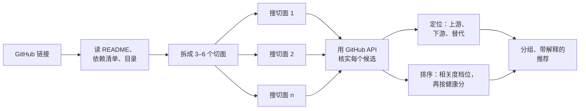

<div align="center">

# repo-compass

**为任意 GitHub 仓库找相似项目和更好的替代品。**

*这个 GitHub 仓库到底处在什么位置，我该用它吗？*

一个 agent skill（也是 Claude Code 插件）：输入一个 GitHub 链接，输出一张地图——它由哪几个面构成、建在什么上面、谁建在它上面、有哪些替代品、每一个的健康状况如何。每一句判断都能追溯到抓取过的页面或 API 数字。

[English](README.md) · [简体中文](README.zh-CN.md)

[](LICENSE)
[](https://github.com/exordor/repo-compass/stargazers)
[](skills/github-similar-repos/SKILL.md)
[](#安装)

</div>

---

## 问题

GitHub 没有"相关仓库"。Trending 按 star 增速排，给你看的是本周刷屏的东西；Topics 是一个扁平的标签袋；首页 feed 是你关注的人 star 了什么。当一个链接从时间线上掉到你面前时，没有一个能回答你真正的问题：

> *这是正经东西，还是某个更成熟项目的薄封装？还有谁在做这个？它还在维护吗？我该选哪个？*

repo-compass 回答这些问题，对任何仓库都行——包括那些 Trending 永远不会推给你的 40 星小仓库。

## 你会得到什么

在装了这个 skill 的 agent 里贴一个链接：

```
在推特上刷到 https://github.com/hugohe3/ppt-master，星很多。
它到底是建在什么上面的？值得用吗，还是有更好的替代？
```

返回大致是这样（节选自[完整样例](examples/hugohe3-ppt-master.md)）：

> **定位。** ppt-master 是一个 agent skill，不是独立 App：LLM 逐页写受约束的 SVG，仓库自带的 `svg_to_pptx` 包把它编译成原生 DrawingML，`python-pptx` 只当外壳用——所以它**不是** PptxGenJS 或 html2pptx 的包装。切面：文档→可编辑 PPT（意图）；LLM 写 SVG → 自研转换器（路线）；agent skill（形态）；原生 PowerPoint 对象模型（签名）。
> **健康度：** 2025-12-10 创建，★63.5k（约 200/天，近 30 天 +8k），昨天有推送，9 个 open issue，MIT。仍在爆发期的 launch，不是 institution。
>
> **下游。** `byungjunjang/slide-master`（★289）自称定制 fork。暂无移植或 UI。
>
> **替代 —— 同一件事，不同取舍**
> - `presenton`（★10.8k，Apache-2.0）— Web 应用 + API + MCP。团队要托管工具选它；在编程 agent 里干活选 ppt-master。
> - `banana-slides`（★15.3k，AGPL，三个月没更新）— 图片模型路线，每页是一张生成图。视觉优先选它，但输出不可编辑。
> - `icip-cas/PPTAgent`（★5.1k）— html2pptx 路线背后的研究项目，不支持 Windows。
>
> **结论：** 在"原生可编辑 PPTX"这条路线上，ppt-master 目前是最成熟、最活跃的选择。
>
> **最接近 —— 重合最多切面** … **同一路线** … **同一生态** … *（分组列表继续）*

另外五个领域的完整运行结果在 [`examples/`](examples/)。

## 安装

repo-compass 是标准的 [Agent Skill](https://agentskills.io)：一个带 `SKILL.md` 的文件夹。需要一个能搜索网页、抓取页面的 agent（Claude Code、Codex、Cursor、Gemini CLI 等大多数都可以）。

**作为 Claude Code 插件**

```
/plugin marketplace add exordor/repo-compass
/plugin install repo-compass@repo-compass
```

**任何兼容 skill 的 agent**

```bash
npx skills add exordor/repo-compass
```

**手动**

```bash
git clone https://github.com/exordor/repo-compass
cp -r repo-compass/skills/github-similar-repos ~/.claude/skills/
```

然后贴一个 GitHub 链接问就行："有什么相似的"、"这是不是最好的"、"它建在什么上面"、"还有谁在做这个"。skill 按意图触发，不需要特定关键词。

## 工作原理

核心想法是：**一个仓库从来不只是一个东西**。同一个仓库同时是某个问题的解法、一条技术路线、一类产出物、某个生态的成员、以及一个不寻常的选择。对单个 embedding 做最近邻搜索会把这一切压成"综合最像"，而综合最像往往就是同一作者的另一个仓库。repo-compass 对每个切面分别搜索，并且在输出里保留切面。



**切面。** 意图（解决什么问题、给谁用）、技术路线（从依赖清单读，这是仓库最诚实的信号）、产出形态（库 / CLI / skill / 作品集 / 数据集 / 教程…）、生态（Claude Code skills、HuggingFace、Obsidian 插件…），以及*签名*：你向朋友描述它时第一个会提到的那个细节。签名是大多数工具跳过的切面，也是找到最佳匹配的那个。见 [`references/facets.md`](skills/github-similar-repos/references/facets.md)。

**核实不可省略。** 搜索摘要靠省略撒谎。每个推荐出的仓库都会对 `api.github.com/repos/<owner>/<repo>` 核对一次，这一步同时能抓到改名、转移、归档和 fork。测试中它抓到过一个已重定向到另一家公司项目的仓库、一个前一年归档的仓库、以及四个自 awesome-list 写成后换了主人的仓库。

**两层排序。** 相关度在前，由模型判断：重合几个切面，或者是不是同一件事。健康度在后，只在同一档位内排序。路线完全一致的 40 星仓库排在只沾一个边的 10k 星仓库前面——否则输出就退化回 Trending。

**健康分**（`scripts/repo_health.py`）是一个 0–100 的汇总，输出里同时展示构成它的各列：

| 信号 | 权重 | 原因 |
|---|---|---|
| 距最后推送的天数 | 35% | 判断"还有没有人在"最硬的一个事实。半衰期 90 天。 |
| 热度 | 25% | log₁₀(star)，让 10 万星项目不至于淹没一切；star 日增高的加分。 |
| 维护 | 25% | issue 关闭率和 PR 合并率。仓库接口的 `open_issues_count` 偷偷含了 PR，脚本单独数。 |
| 成熟度 | 15% | 存在年限（3 年封顶）和是否有正式 release。 |

star 数永远和**创建以来的日增**并排显示。30 天 2 万星和 5 年 2 万星是两种东西：前者是 launch，后者是 institution，你应该知道自己看的是哪一种。

## 和已有工具的区别

| | Trending / Explore | SimRepo、GitRec | repo-compass |
|---|---|---|---|
| 信号 | star 增速 | star 共现 / 协同过滤 | README + 依赖清单 + topics，由 LLM 阅读 |
| 能找到 100 星以下的仓库 | 否 | 很少（需要有人共同 star） | 能——这就是目的 |
| 解释"为什么相关" | 否 | 否 | 每一行 |
| 上游 / 下游 | 否 | 否 | 有 |
| 替代品 + 判断 | 否 | 否 | 有，附 API 数字 |
| 延迟 | 即时 | 即时 | 每次 2–5 分钟 |
| 成本 | 免费 | 免费 | 你的 agent token |

最后两行是真实的取舍。[SimRepo](https://github.com/Mubelotix/SimRepo) 和 [GitRec](https://github.com/gorse-io/gitrec) 即时且免费，适合在侧栏瞄一眼；repo-compass 适合你在决定要不要依赖某个东西的那一刻。两条路互补，把它们结合起来在路线图上。

## 样例

| 输入 | 领域 | 这次运行发现了什么 |
|---|---|---|
| [karpathy/nanochat](examples/karpathy-nanochat.md) | LLM 训练 | 把真正的同类（minimind、modded-nanogpt）和作者自己的系谱分开；找到一个 12 星、保留同一 time-to-GPT-2 指标的 JAX 移植 |
| [ollama/ollama](examples/ollama-ollama.md) | 本地推理 | 签名"Docker 式 pull/run + Modelfile"指向 ramalama 和 docker/model-runner（★645），而不是 vLLM |
| [shadcn-ui/ui](examples/shadcn-ui-ui.md) | UI 组件 | 签名"不发 npm 包，代码归你"让各框架移植成为最接近组，排除了传统组件库 |
| [openai/whisper](examples/openai-whisper.md) | 语音 | 区分"同一件事、自己的权重"（OWSM、Canary）和"Whisper 权重的加速器"（whisper.cpp、faster-whisper） |
| [chuspeeism/dashi-ppt-skill](examples/chuspeeism-dashi-ppt-skill.md) | Agent skills | 把领域拆成三条路线（HTML 幻灯片 / 直接写 PPTX / 图片幻灯片），把输入定位在交界处 |
| [hugohe3/ppt-master](examples/hugohe3-ppt-master.md) | Agent skills，定位 | 确认它是基础设施（自研 SVG→DrawingML 编译器）而非包装；给出替代品和判断 |

## 局限

- **慢。** 每次 2–5 分钟、30–50 次工具调用，大部分花在核实上。这是不推荐 fork 和死项目的代价。
- **agent 需要联网。** 必须有网页搜索和页面抓取。`repo_health.py` 还需要 shell 能访问 `api.github.com`；在屏蔽它的沙箱里，skill 会退回到用 agent 的抓取工具取同样的字段。
- **替代品判断依赖对 README 的理解。** 健康数字是硬的，"更适合 X"那句话是模型对两份 README 的解读。把它当作附带证据的知情意见，不是 benchmark。
- **未认证的 GitHub API 每小时 60 次。** 跑得多的话给 `repo_health.py` 设 `GITHUB_TOKEN`。

## 路线图

- [ ] 浏览器插件：github.com 侧栏按需运行 skill，先用 SimRepo 式的即时结果占位
- [ ] 跨运行缓存已核实的仓库元数据
- [ ] 在可用的地方接 GitHub dependency API 拿下游依赖图
- [ ] 拥挤切面的溢出页，而不是截断
- [ ] 评测集：几十对"仓库 → 预期同类"，用来测回归

## 常见问题

**怎么找相似的 GitHub 仓库？**
GitHub 没有"相关仓库"功能。在 agent 里装好 repo-compass，贴任意仓库链接问"有什么类似的"，得到按共同点分组的同类项目（同一问题、同一技术路线、同一生态、同一标志性特点），每个都附一句理由。

**怎么找某个开源项目的替代品？**
问"有没有比它更好的"。**替代**一节列出做同一件事的仓库，附 star、日均 star、最近推送时间和一句"更适合……"，最后给出结论。

**怎么判断一个 GitHub 仓库还有没有人维护？**
`scripts/repo_health.py` 根据最近推送天数、issue 关闭率、PR 合并率、是否发版和对数化的 star 给出 0–100 分，也可以单独运行：`python skills/github-similar-repos/scripts/repo_health.py --tier "1:owner/repo"`。

**它是套壳，还是真东西？**
**定位**一段会读依赖清单，说明它建在什么之上（上游），并搜索基于它的移植、插件和 fork（下游）。

**支持哪些 agent？**
任何能加载 [Agent Skills](https://agentskills.io) 并能联网搜索的 agent：Claude Code、OpenAI Codex、Cursor、Gemini CLI 等。

**和 GitHub Trending、Topics、SimRepo 有什么区别？**
见[和已有工具的区别](#和已有工具的区别)。简单说：它能找到基于 star 的工具漏掉的小仓库，并解释每一条推荐。

如果 repo-compass 帮你选定了依赖，点个 ⭐ 能让更多人发现它。

## 贡献

欢迎 issue 和 PR。最有用的贡献是一次跑偏的运行：开一个 issue，附上输入链接、输出，以及这个领域里内行的人会怎么说。见 [CONTRIBUTING.md](CONTRIBUTING.md)。

## 许可证

[MIT](LICENSE)
